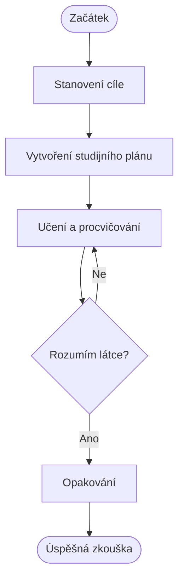

#  Příručka přežití zkouškového období

> Praktický průvodce pro každého studenta, který chce zvládnout zkoušky, stres a nedostatek času.  
> **Cíl:** Naučit se efektivně, zachovat klid a úspěšně dokončit školní rok.

---

##  1. Jak se správně připravit na zkoušky

Příprava na zkoušky nemusí být stresující. Důležité je správně si rozvrhnout čas, pravidelně opakovat učivo a nezapomínat na odpočinek.

### 1.1 Plánování času

- Vytvoř si seznam všech předmětů.
- Rozděl si učivo na menší části.
- Stanov si realistické cíle.
- Každý den si zopakuj již naučenou látku.

### 1.2 Metoda Pomodoro

Metoda Pomodoro pomáhá udržet pozornost a zvýšit produktivitu.

1. Uč se 25 minut.
2. Dej si 5 minut přestávku.
3. Opakuj tento postup čtyřikrát.
4. Potom si dopřej delší přestávku (15–30 minut).

*Tip: Během učení odlož mobilní telefon a vypni zbytečná upozornění.*

---

##  2. Důležité zásady úspěšného studia

Pro úspěšné zvládnutí zkoušek je důležité dodržovat několik pravidel:

- **Pravidelnost** – uč se raději každý den než všechno najednou.
- **Trpělivost** – ne každou látku pochopíš okamžitě.
- **Odpočinek** – kvalitní spánek je důležitý pro paměť.
- **Motivace** – stanov si odměnu za splněné cíle.

Nezapomeň: ~~Učit se všechno poslední večer je nejlepší strategie.~~ To opravdu není!

### 2.1 Co si připravit?

- Sešity a učebnice
- Notebook nebo počítač
- Psací potřeby
- Dostatek vody
- Klidné místo na učení

---

##  3. Porovnání studijních metod

| Metoda | Výhody | Nevýhody |
|:---|:---|:---|
| Pomodoro | Lepší soustředění | Nutnost dodržovat čas |
| Myšlenkové mapy | Přehledné informace | Náročnější příprava |
| Opakování poznámek | Jednoduchost | Může být méně efektivní |
| Skupinové učení | Sdílení znalostí | Možnost rozptylování |

---

##  4. Můj studijní To-Do seznam

Při přípravě na zkoušky můžeš použít následující seznam:

- [x] Připravit si studijní materiály
- [x] Vytvořit studijní plán
- [ ] Zopakovat matematiku
- [ ] Naučit se angličtinu
- [ ] Procvičit programování
- [ ] Připravit se na závěrečné testy
- [ ] Dopřát si zasloužený odpočinek

---

##  5. Ukázka jednoduchého programu v Pythonu

Následující program vypočítá, kolik hodin student stráví učením za jeden týden.

```python
# Studijní plán na jeden týden

predmety = {
    "Matematika": 3,
    "Angličtina": 2,
    "Programování": 4,
    "Čeština": 2
}

celkem = sum(predmety.values())

print("Můj studijní plán:")
for predmet, hodiny in predmety.items():
    print(f"{predmet}: {hodiny} hodin")

print(f"Celkem hodin učení: {celkem}")
```

**Výsledek:** Celkem 11 hodin studia týdně.

---

##  6. Užitečné odkazy

Pokud chceš své studium ještě zlepšit, vyzkoušej následující stránky:

- [GitHub Docs](https://docs.github.com/) – dokumentace a návody pro práci s GitHubem.
- [Khan Academy](https://www.khanacademy.org/) – bezplatné vzdělávací materiály.
- [Python Documentation](https://docs.python.org/3/) – oficiální dokumentace Pythonu.

---

##  7. Inspirace pro studium

Obrázek znázorňující ideální studijní prostředí.


---

##  8. Matematická specialita – dobrovolný úkol

Pro výpočet celkového času učení můžeme použít jednoduchý matematický vzorec:

$$
T = \sum_{i=1}^{n} t_i
$$

Kde:
- \(T\) je celkový čas učení.
- \(t_i\) je čas věnovaný jednotlivému předmětu.
- \(n\) je počet předmětů.

---

##  9. Diagram studijního procesu – Mermaid



---

##  Závěr

Úspěšné studium není o tom, kolik hodin strávíš nad učebnicí, ale především o tom, jak efektivně svůj čas využiješ.

**Pamatuj:** Každý malý krok tě přibližuje k tvému cíli!

---

*Vytvořeno jako školní projekt Master of Markdown na GitHubu.*

**Autor:** Michail Izbas  
**Rok:** 2026
